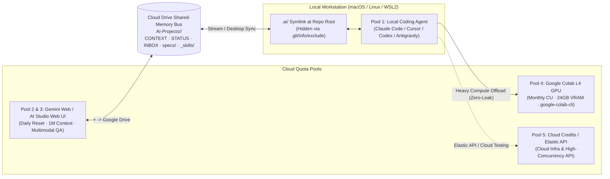

# ai-ultra-5pool-kit

English | [简体中文](README.zh-CN.md)

[](LICENSE)

> **Stop burning your rolling coding-agent quota on everything.**
> Split one AI subscription across **5 isolated compute pools** connected by a plain-text cloud `.ai/` symlink bus, an AI Studio Web UI preset, and a Zero-Leak Colab L4 GPU offload workflow.

---

## The Problem

Solo developers running multiple projects with AI coding agents (Claude Code, Cursor, Codex, Antigravity, Windsurf, etc.) quickly hit two walls:

1. **Stuffing everything into Pool 1**: Large-context doc reading, draft writing, media analysis, and heavy GPU scripts drain your local coding agent's rolling window in hours.
2. **Multi-account Family Group switching fails**: Core coding-agent plans enforce a **Shared Quota Pool** across the family group — once the primary pool hits limit, secondary accounts are rate-limited too.

**The solution is horizontal cross-pool routing, not vertical account switching**: route heavy reading/JSON generation to AI Studio Web (daily free quota), route heavy VRAM/compute jobs to Colab L4 (`google-colab-cli`), and keep your local coding agent strictly for high-leverage multi-file code edits, builds, and tests.

## Architecture Overview



## 5-Pool Workload Routing Matrix

| Pool | Billing / Reset Cycle | Ideal Workloads | Never Send Here | Toolkit Component |
| :--- | :--- | :--- | :--- | :--- |
| **Pool 1: Local Coding Agent** | Rolling window | Multi-file edits, builds, typechecks, tests, git ops | 100k-token reading, heavy GPU inference | `bin/ai-link`, `skills/ai-cloud-sync/` |
| **Pool 2: Web Research + Cloud Drive** | Rolling window + Cloud Drive | Deep research, cross-device context & skill sync | Direct local repo mutations | `bin/ai-link` (`.ai/` & `--sync-skills`) |
| **Pool 3: AI Studio Web UI** | Daily reset (prompt-based) | Long-context synthesis, structured JSON, video/audio QA | High-frequency tiny file edits | `templates/AISTUDIO-SYSTEM-INSTRUCTIONS.md` |
| **Pool 4: Colab GPU (`colab` CLI)** | Monthly CU (`--gpu L4`) | ML inference, voice/audio jobs, parallel headless render | Idle VMs; heavy small-file I/O on Drive FUSE | `skills/colab-gpu-offload/` + `colab_zero_leak.sh` |
| **Pool 5: Cloud Credits / API** | Credits / Pay-as-you-go | Cloud Run/VMs, scripted high-concurrency model calls | Unmonitored runs without budget alerts | `docs/ROUTING-PLAYBOOK.md` |

Read the complete dispatch rules and guardrails in [docs/ROUTING-PLAYBOOK.md](docs/ROUTING-PLAYBOOK.md) ([中文版](docs/ROUTING-PLAYBOOK.zh-CN.md)).

## Repository Structure

```text
ai-ultra-5pool-kit/
├── bin/
│   └── ai-link                         # Cross-platform .ai/ symlink bridge, .git/info/exclude & skill sync
├── docs/
│   ├── ROUTING-PLAYBOOK.md             # 5-pool dispatch decision tree & Zero-Leak guardrails
│   └── ROUTING-PLAYBOOK.zh-CN.md       # 中文版派活手册
├── examples/
│   └── fictional-webapp/               # Filled-in example of Cloud AI Studio -> .ai/ -> Local + Colab L4
├── skills/
│   ├── ai-cloud-sync/SKILL.md          # Agent Skill for reading/updating .ai/CONTEXT|STATUS|INBOX
│   └── colab-gpu-offload/
│       ├── SKILL.md                    # 5 Zero-Leak & /content/scratch/ iron laws for google-colab-cli
│       └── scripts/colab_zero_leak.sh  # trap cleanup EXIT wrapper (never leaves idle Colab VMs)
├── templates/
│   ├── CONTEXT.template.md
│   ├── STATUS.template.md
│   ├── INBOX.template.md
│   ├── HANDOFF-FOR-AGENT.template.md
│   ├── AISTUDIO-SYSTEM-INSTRUCTIONS.md # Web UI preset for Google Drive-attached research
│   ├── GLOBAL-AGENT-RULES.md           # Global snippet for CLAUDE.md / AGENTS.md / Cursor rules
│   └── skills.example.json             # Optional ~/.config/ai-link/skills.json config
└── tests/
    └── test_ai_ultra_kit.sh            # Offline automated verification suite
```

## 5-Minute Quick Start

### 1. Install `ai-link` & Agent Skills

Works on **macOS, Linux, Windows WSL2, and Git Bash**:

```bash
git clone https://github.com/IMYin/ai-ultra-5pool-kit.git
cd ai-ultra-5pool-kit

mkdir -p ~/.local/bin ~/.agents/skills ~/.claude/skills
cp bin/ai-link ~/.local/bin/
chmod +x ~/.local/bin/ai-link

cp -r skills/ai-cloud-sync skills/colab-gpu-offload ~/.agents/skills/
# If you also use Claude Code:
cp -r skills/ai-cloud-sync skills/colab-gpu-offload ~/.claude/skills/
```

Ensure `~/.local/bin` is on your `PATH`.

### 2. Connect Your Cloud Hub (`ai-link`)

`ai-link` auto-detects Google Drive desktop mounts on macOS, Linux, and WSL2 (`G:\My Drive`). If you use iCloud Drive, Dropbox, OneDrive, Syncthing, or a custom folder, point it once with `--set-hub`:

```bash
# Optional: set a custom synced directory (iCloud, Dropbox, OneDrive, custom mount)
ai-link --set-hub ~/Dropbox/AI-Projects

# 1) Initialize _REGISTRY.md, _GLOBAL_INBOX.md, and _skills/
ai-link --init-hub

# 2) Inside any local Git repo, create `.ai/` symlink + `.git/info/exclude` + AGENTS.md rules
cd /path/to/your-repo
ai-link

# 3) Bidirectionally sync custom skills & build _skills/_INDEX.md
ai-link --sync-skills
```

To safely detach a repository later (without deleting cloud files), run `ai-link --unlink`.

### 3. Configure AI Studio Web UI & Colab L4 Offload

1. Copy [`templates/AISTUDIO-SYSTEM-INSTRUCTIONS.md`](templates/AISTUDIO-SYSTEM-INSTRUCTIONS.md) into one reusable System Instructions preset in Google AI Studio Web UI. Attach `CONTEXT.md` or `_skills/<skill>/SKILL.md` via **+ -> Google Drive**.
2. Install Google's official CLI and run heavy GPU jobs with Zero-Leak protection:

```bash
uv tool install git+https://github.com/googlecolab/google-colab-cli
colab sessions   # completes OAuth once
colab usage      # check compute unit balance

~/.agents/skills/colab-gpu-offload/scripts/colab_zero_leak.sh \
  --drive my-worker ./remote_job.py /content/scratch/output.bin ./output.bin
```

Want to see what a linked workspace looks like in practice? Inspect [`examples/fictional-webapp/`](examples/fictional-webapp/).

## Verification

Run the offline integration test suite (uses isolated temp directories only):

```bash
bash tests/test_ai_ultra_kit.sh
```

## Sibling Repositories

- [`IMYin/ai-agent-team-playbook`](https://github.com/IMYin/ai-agent-team-playbook) — Plain-text rules, `LESSONS.md`, contracts, and handoffs for running a team of coding agents
- [`IMYin/chinese-human-voice`](https://github.com/IMYin/chinese-human-voice) — Anti-AI-slop Chinese writing skill
- [`IMYin/align-agent-prompt`](https://github.com/IMYin/align-agent-prompt) — Align fuzzy ideas into actionable agent prompts before execution

## License

[MIT](LICENSE)
