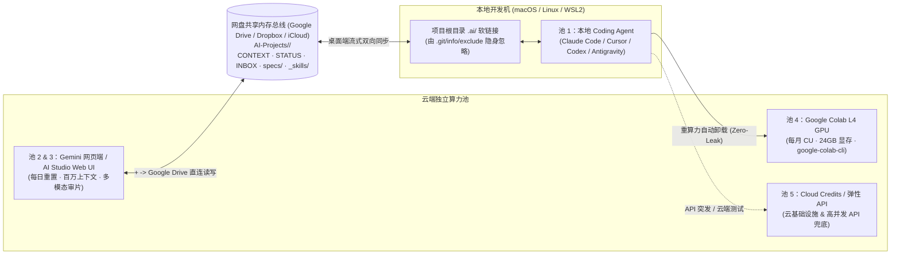

# ai-ultra-5pool-kit · 一份订阅拆出 5 个独立算力池的多引擎协调架构

[English](README.md) | 简体中文

[](LICENSE)

> **把所有活全塞进同一个本地 Coding Agent，额度条一定很快见底。**
> 这套开源协调架构通过 **云盘 `.ai/` 软链接内存总线 + Google AI Studio 网页端工位预设 + Colab L4 零漏电（Zero-Leak）卸载 Skill**，把一份 AI 订阅拆成 5 个互不抢额度的独立算力池协同工作。

---

## 为什么需要这套架构

一个人带多个项目用 AI 干活时，最常见两个瓶颈：

1. **所有任务全压在池 1（本地 Coding Agent）**：动辄几万字资料泛读、文案整理、音视频审阅、重显卡脚本全让 Claude Code / Cursor / Codex / Antigravity 硬扛，滚动周期额度几小时就被读空。
2. **家庭组纵向切号行不通**：以为建家庭组切小号登录能翻倍额度——现在核心编码 Agent 对家庭组普遍实行**共池限额（Shared Quota Pool）**，主号跑满，小号照样原地限流。

**正确的破局方式不是“纵向切号”，而是“横向跨池分流”**：用纯文本协议把重文科/长上下文分流到 AI Studio 网页端，把重显存/大带宽批处理卸载到 Colab L4 显卡，把本地 Coding Agent 留给真正需要多文件改代码、跑单测与 Git 提交的最后一步。

## 架构总览



## 5 池分流矩阵

| 算力池 | 计量 / 刷新机制 | 最适合干什么 | 严禁塞什么 | 本仓库对应组件 |
| :--- | :--- | :--- | :--- | :--- |
| **池 1：本地 Coding Agent** | 滚动周期配额 | 改多文件代码、跑类型检查与单测、Git 操作 | 大段背景资料泛读、纯文案初稿、重显卡推理 | `bin/ai-link`、`skills/ai-cloud-sync/` |
| **池 2：网页端深度研究 + 云盘** | 独立滚动周期 + 云盘空间 | Deep Research、跨设备共享项目文档与 Skill | 直接修改本地 Git 仓库 | `bin/ai-link`（`.ai/` 与 `--sync-skills`） |
| **池 3：AI Studio Web UI** | 每日重置（按请求频次） | 百万上下文文献/代码梳理、结构化 JSON、音视频审片 | 高频小文件读写 | `templates/AISTUDIO-SYSTEM-INSTRUCTIONS.md` |
| **池 4：Colab GPU (`colab` CLI)** | 每月计算单元（主推 `--gpu L4`） | 模型推理、音视频批处理、无头浏览器并发渲染 | 跑完忘关机空转；直接高频随机写 Drive | `skills/colab-gpu-offload/` + `colab_zero_leak.sh` |
| **池 5：Cloud Credits / API** | 促销抵扣金 / 按量计费 | 轻量云服务（Cloud Run / GCE）或高并发 API 兜底 | 无预算告警的高并发消费 | `docs/ROUTING-PLAYBOOK.zh-CN.md` |

完整的派活决策树与防漏电铁律见：[docs/ROUTING-PLAYBOOK.zh-CN.md](docs/ROUTING-PLAYBOOK.zh-CN.md)。

## 仓库结构

```text
ai-ultra-5pool-kit/
├── bin/
│   └── ai-link                         # 跨平台 .ai/ 软链接桥接 + .git/info/exclude + 双向 Skill 同步
├── docs/
│   ├── ROUTING-PLAYBOOK.md             # 英文版 5 池派活决策树与铁律
│   └── ROUTING-PLAYBOOK.zh-CN.md       # 中文版 5 池派活决策树与铁律
├── examples/
│   └── fictional-webapp/               # 完整填好可直接照抄的跨端协作闭环示例
├── skills/
│   ├── ai-cloud-sync/SKILL.md          # 本地 Agent 启动必读 / 收工回写 .ai/ 技能
│   └── colab-gpu-offload/
│       ├── SKILL.md                    # 触发场景 + 5 条 Colab L4 防漏电铁律
│       └── scripts/colab_zero_leak.sh  # trap cleanup EXIT 强制停机验尸脚本
├── templates/
│   ├── CONTEXT.template.md             # 架构真源模板
│   ├── STATUS.template.md              # 进度看板模板
│   ├── INBOX.template.md               # 云端 -> 本地收件箱模板
│   ├── HANDOFF-FOR-AGENT.template.md   # 云端交付本地执行的任务书模板
│   ├── AISTUDIO-SYSTEM-INSTRUCTIONS.md # Google AI Studio 网页端工位 System Instructions 预设
│   ├── GLOBAL-AGENT-RULES.md           # 全局 CLAUDE.md / AGENTS.md / Cursor 规则片段
│   └── skills.example.json             # 自定义 ai-link --sync-skills 映射与忽略列表（可选）
└── tests/
    └── test_ai_ultra_kit.sh            # 离线自动化验证脚本
```

## 5 分钟快速上手

### 1. 安装 `ai-link` 与 Agent Skills

支持 **macOS、Linux、Windows WSL2 / Git Bash**：

```bash
git clone https://github.com/IMYin/ai-ultra-5pool-kit.git
cd ai-ultra-5pool-kit

mkdir -p ~/.local/bin ~/.agents/skills ~/.claude/skills
cp bin/ai-link ~/.local/bin/
chmod +x ~/.local/bin/ai-link

cp -r skills/ai-cloud-sync skills/colab-gpu-offload ~/.agents/skills/
# 如果使用 Claude Code：
cp -r skills/ai-cloud-sync skills/colab-gpu-offload ~/.claude/skills/
```

确认 `~/.local/bin` 已加入环境变量 `PATH`。

### 2. 打通 `.ai/` 跨端内存总线（`ai-link`）

默认自动探测 macOS / Linux / WSL2 的 Google Drive 挂载路径；如果你用 **iCloud、Dropbox、OneDrive、Syncthing 或自定义目录**，用 `--set-hub` 指定一次即可持久化：

```bash
# 可选：自定义任意网盘/同步目录
ai-link --set-hub ~/Dropbox/AI-Projects

# 1) 初始化云端总控目录（_REGISTRY.md、_GLOBAL_INBOX.md、_skills/）
ai-link --init-hub

# 2) 进入任意本地 Git 仓库，建 .ai/ 软链接 + 写 .git/info/exclude + 注入 AGENTS.md 同步规则
cd /path/to/your-project
ai-link

# 3) 自动发现本地自定义 Skill 并与云端 _skills/ 双向同步
ai-link --sync-skills
```

若想安全解绑当前仓库的 `.ai/`（不删云端文件），执行 `ai-link --unlink`。

### 3. 配置 AI Studio 网页端工位 & Colab L4 卸载

1. 在 AI Studio Web UI 新建 1 个 System Instructions 预设，贴入 [`templates/AISTUDIO-SYSTEM-INSTRUCTIONS.md`](templates/AISTUDIO-SYSTEM-INSTRUCTIONS.md)。开工时点 **`+ -> Google Drive`** 挂载项目的 `CONTEXT.md` 与 `_skills/xxx/SKILL.md`，让它把方案写进 `.ai/INBOX.md` 与 `.ai/specs/`。
2. 安装官方 `google-colab-cli` 并用 Zero-Leak 封装器卸载重算力任务：

```bash
uv tool install git+https://github.com/googlecolab/google-colab-cli
colab sessions   # 首次完成浏览器 OAuth 授权
colab usage      # 核验计算单元余额

# 带 trap cleanup EXIT 的零漏电脚本：无论成败自动停机并核验零残留
~/.agents/skills/colab-gpu-offload/scripts/colab_zero_leak.sh \
  --drive my-worker ./remote_job.py /content/scratch/output.bin ./output.bin
```

想看填好的真实协作长什么样？直接参考 [`examples/fictional-webapp/`](examples/fictional-webapp/)。

## 离线验证

```bash
bash tests/test_ai_ultra_kit.sh
```

## 姊妹仓库

- [`IMYin/ai-agent-team-playbook`](https://github.com/IMYin/ai-agent-team-playbook) — 单人带多 Agent 团队的纯文本记忆、`LESSONS.md` 与任务合同模板
- [`IMYin/chinese-human-voice`](https://github.com/IMYin/chinese-human-voice) — 让 AI 写的中文更像真人的去 AI 味 Skill
- [`IMYin/align-agent-prompt`](https://github.com/IMYin/align-agent-prompt) — 把模糊想法先对齐再交给执行 Agent 的 Prompt 技能

## 开源协议

[MIT](LICENSE)
